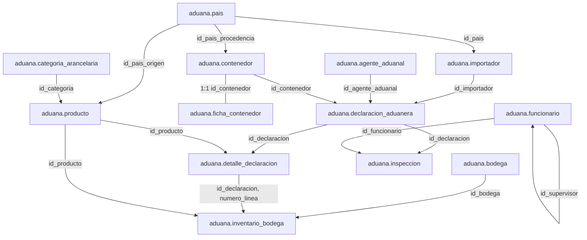

# Reglas de Negocio, Cardinalidades y Contrato del Esquema

- **Proyecto:** Laboratorio #3: Sistema de inventario para una aduana: base de datos relacional y agente de IA con n8n
- **Autor:** Reymond Salguero
- **Fecha:** Octubre de 2026
- **Plataforma:** Supabase | **Motor:** PostgreSQL 18
- **Esquema:** `aduana`

---

## 1. Justificación de Entidades y Cardinalidades (Mínimas y Máximas)

El modelo relacional se fundamenta en doce entidades base de la operativa aduanera y una decimotercera entidad complementaria (`ficha_contenedor`) diseñada para satisfacer y justificar una relación uno a uno (1:1) estricta en el motor relacional.

### 1.1 Matriz de Cardinalidades Formales

| Entidad Origen (A) | Cardinalidad (A $\to$ B) | Entidad Destino (B) | Notación Formal | Justificación Operativa |
| :--- | :---: | :--- | :---: | :--- |
| `pais` | **1 : N** | `importador` | $1..1 \to 0..N$ | Un país puede albergar a múltiples importadores constituidos en él; todo importador debe pertenecer obligatoriamente a exactamente un país de domicilio fiscal. |
| `pais` | **1 : N** | `producto` | $1..1 \to 0..N$ | Un país puede ser el origen/fabricación de muchos productos; todo producto tiene exactamente un país de manufactura o cosecha de origen. |
| `pais` | **1 : N** | `contenedor` | $1..1 \to 0..N$ | Un país puede despachar muchos contenedores; cada contenedor tiene documentado su país de procedencia física de embarque. |
| `categoria_arancelaria` | **1 : N** | `producto` | $1..1 \to 0..N$ | Una subpartida arancelaria clasifica a múltiples productos comerciales; cada producto corresponde a una única subpartida arancelaria. |
| `contenedor` | **1 : 1** | `ficha_contenedor` | $0..1 \to 1..1$ | **Relación 1:1 justificada.** Un contenedor físico en el recinto aduanero puede o no tener emitida aún su ficha técnica y precinto aduanero ($0..1$). Toda ficha de contenedor corresponde inequívocamente a exactamente un único contenedor físico ($1..1$). |
| `importador` | **1 : N** | `declaracion_aduanera` | $1..1 \to 0..N$ | Un importador puede registrar múltiples DUAs a lo largo del tiempo; toda declaración pertenece a un único importador declarante. |
| `agente_aduanal` | **1 : N** | `declaracion_aduanera` | $1..1 \to 0..N$ | Un agente aduanal refrenda y tramita muchos DUAs; cada DUA está suscrito por un único agente aduanero habilitado. |
| `contenedor` | **1 : N** | `declaracion_aduanera` | $1..1 \to 0..N$ | Un contenedor transporta la carga de una declaración aduanera (o varias en consolidación); cada DUA está asignado a un contenedor de arribo. |
| `declaracion_aduanera` | **1 : N** | `detalle_declaracion` | $1..1 \to 1..N$ | Una declaración aduanera contiene una o más líneas de mercancía; cada línea de detalle pertenece a exactamente una declaración. |
| `producto` | **1 : N** | `detalle_declaracion` | $1..1 \to 0..N$ | Un producto de catálogo puede declararse en múltiples líneas de diferentes DUAs; cada línea ampara a un único producto. |
| `declaracion_aduanera` | **1 : N** | `inspeccion` | $1..1 \to 0..N$ | Un DUA puede ser sometido a cero, una o varias diligencias de aforo o inspección física; cada acta de inspección pertenece a un solo DUA. |
| `funcionario` | **1 : N** | `inspeccion` | $1..1 \to 0..N$ | Un inspector aduanero practica y suscribe múltiples actas de aforo; cada inspección es conducida y dictaminada por un funcionario responsable. |
| `funcionario` (Supervisor) | **1 : N** | `funcionario` (Subordinado) | $0..1 \to 0..N$ | **Relación jerárquica recursiva.** Un funcionario puede supervisar a varios colegas; un funcionario subordinado tiene un supervisor directo, o `NULL` si ostenta la jefatura superior. |
| `bodega` | **1 : N** | `inventario_bodega` | $1..1 \to 0..N$ | Una bodega almacena múltiples posiciones y mercancías; cada registro de existencia está ubicado en exactamente una bodega. |
| `detalle_declaracion` | **1 : N** | `inventario_bodega` | $1..1 \to 0..N$ | Una línea declarada de un DUA puede ingresar y custodiarse en bodega; cada registro de inventario está estrictamente amparado en una línea de DUA. |
| `producto` | **1 : N** | `inventario_bodega` | $1..1 \to 0..N$ | Clave foránea redundante de integridad referencial para consultar existencias físicas directas de un producto por bodega. |

---

## 2. Decisiones de Diseño y Solución de Desafíos Relacionales

### 2.1 Justificación de la Relación 1:1 (`contenedor` $\leftrightarrow$ `ficha_contenedor`)
Para modelar formalmente la relación 1:1 requerida por las mejores prácticas del diseño relacional:
- **Estructura en BD:** La tabla `aduana.ficha_contenedor` utiliza `id_contenedor` como su llave primaria (`PRIMARY KEY`) y simultáneamente como llave foránea (`REFERENCES aduana.contenedor(id_contenedor)`).
- **Semántica de Participación:** La participación es **opcional desde el contenedor** ($0..1$), ya que un contenedor en tránsito preliminar o vacío en patio portuario puede existir sin que se le haya levantado o asignado todavía un precinto aduanero formal o ficha climática. Por el contrario, la participación es **obligatoria y única desde la ficha** ($1..1$), pues una ficha técnica no puede existir sin su contenedor físico.
- **Principio de Rigor:** En SQL ordinario, definir una columna `UNIQUE NOT NULL` como llave foránea hacia un padre **no garantiza** que toda fila del padre posea obligatoriamente un hijo; únicamente restringe que ningún hijo apunte al mismo padre más de una vez. Al definir la PK de la ficha como FK del contenedor, el motor asegura que no existan dos fichas para el mismo contenedor. La obligatoriedad bidireccional estricta (que todo padre tenga forzosamente un hijo) requeriría una restricción de integridad diferida cruzada (`DEFERRABLE INITIALLY DEFERRED`) o una transacción atómica encapsulada en procedimiento almacenado.

### 2.2 Jerarquía Recursiva en `funcionario` y Control de Ciclos
- **Jefatura y Nulabilidad:** La columna `id_supervisor` es nulable (`NULL`) para representar la raíz de la jerarquía aduanera (el Director General o Jefatura de Aduana no tiene supervisor en el recinto).
- **Prevención de Autosupervisión Directa:** Se implementa la restricción a nivel de tabla:
  ```sql
  CONSTRAINT check_no_autosupervision CHECK (id_supervisor IS NULL OR id_supervisor <> id_funcionario)
  ```
  Esto prohíbe de forma inmediata que un funcionario sea su propio supervisor directo ($A \to A$).
- **Control de Ciclos Multinivel ($A \to B \to C \to A$):**
  Un `CHECK` ordinario en SQL estándar opera exclusivamente sobre los valores de la fila entrante y **no puede ejecutar subconsultas ni recorrer la tabla**. Por ende, un constraint CHECK no puede detectar bucles indirectos en múltiples niveles.
  *Estrategia de mitigación en arquitectura PostgreSQL:* Se documenta que el control de ciclos indirectos se previene en producción mediante:
  1. Un trigger `BEFORE INSERT OR UPDATE OF id_supervisor ON aduana.funcionario` que utiliza un **CTE Recursivo** (`WITH RECURSIVE ancestros AS (...)`) para recorrer la línea de mando ascendente y lanzar una excepción si el `id_funcionario` insertado figura entre sus propios supervisores ascendentes.
  2. Procedimientos de negocio en capa de aplicación que validan la aciclicidad del grafo antes de persistir la relación.

### 2.3 Granularidad del Detalle del DUA y Resolución N:M
- La relación de muchos a muchos entre `declaracion_aduanera` y `producto` se descompone a través de la tabla asociativa `detalle_declaracion`.
- **Granularidad:** Se define una **clave primaria compuesta** `(id_declaracion, numero_linea)`.
- **Regla de No Prohibición:** No se coloca una restricción `UNIQUE (id_declaracion, id_producto)`. Esto permite que una misma declaración aduanera incluya el mismo producto en distintas líneas cuando amparan **lotes de producción diferentes, fechas de vencimiento distintas, orígenes de fábrica diferenciados o variaciones en la tasa arancelaria liquidada**.

### 2.4 Trazabilidad de `inventario_bodega` hacia Líneas Declaradas
- **Riesgo Operativo Evitado:** Guardar únicamente `(id_producto, id_bodega)` en el inventario provocaría la pérdida de la trazabilidad jurídica aduanera. Sería imposible responder si 50 unidades de un monitor almacenadas corresponden a una importación **Retenida** por sospecha de contrabando o a un DUA **Liberado** listo para retiro.
- **Implementación Técnica:** `inventario_bodega` almacena la referencia exacta a la cabecera y a la línea del DUA mediante la llave foránea compuesta `(id_declaracion, numero_linea)`.
- **Restricción de No Duplicidad:**
  ```sql
  CONSTRAINT uq_bodega_detalle_declaracion UNIQUE (id_bodega, id_declaracion, numero_linea)
  ```
  Garantiza que una línea de un DUA solo tenga una única entrada de stock por bodega física, preservando la coherencia del inventario.

### 2.5 Desacoplamiento de Orígenes Geográficos (Regla de Oro Analítica)
Para garantizar que las ocho consultas de negocio no produzcan respuestas ambiguas ni falsos positivos, se desacoplan rigurosamente tres dimensiones geográficas distintas:
1. **`producto.id_pais_origen` (País de Fabricación de la Mercancía):** Identifica el país donde el bien fue manufacturado o producido (ej. China). Esta columna es el **único camino relacional válido** para resolver la Consulta 2 («Mercancías con origen China»).
2. **`importador.id_pais` (País de Domicilio del Importador):** Representa el país donde la empresa compradora está legalmente constituida (ej. Costa Rica, Estados Unidos). El hecho de que una empresa estadounidense compre mercancía no significa que la mercancía se fabrique en EE. UU.
3. **`contenedor.id_pais_procedencia` (País de Procedencia del Equipo Intermodal):** Refleja el país de último puerto de embarque logístico de la unidad de carga. Esta columna es el **camino relacional inequívoco** para resolver la Consulta 3 («País o países con mayor número de contenedores»).

### 2.6 Supuesto Operativo: Relación Contenedor - Declaración
- **Supuesto del Laboratorio:** En este modelo operativo, cada declaración aduanera documenta de manera directa el contenedor asignado para su transporte intermodal a través de `declaracion_aduanera.id_contenedor` ($N:1$, donde un contenedor puede contener uno o varios DUAs consolidados, o una asignación unívoca directa).
- **Modelo de Consolidación Ampliado (LCL/FCL):** Si en un entorno comercial extendido una sola declaración requiriese distribuirse a lo largo de 10 contenedores distintos (FCL múltiple) y a su vez cada contenedor transportara mercancías de 20 importadores distintos (LCL consolidado multimodal), se requeriría una tabla asociativa intermedia `aduana.contenedor_declaracion`. Para los objetivos del laboratorio, la vinculación `id_contenedor` en `declaracion_aduanera` proporciona la trazabilidad completa sin sobrediseño innecesario.

### 2.7 Distinción Taxonómica: Régimen vs. Estado
El modelo prohíbe taxativamente mezclar la naturaleza jurídica del trámite con la condición operativa del lote:
- **Regímenes Aduaneros (`declaracion_aduanera.regimen`):**
  - `Importacion`: Nacionalización definitiva de mercancías extranjeras.
  - `Exportacion`: Salida legal de mercancías del territorio nacional.
  - `Transito`: Traslado de mercancías entre aduanas bajo control fiscal.
  - `Deposito`: Almacenamiento temporal en bodegas fiscales habilitadas sin pago inmediato de tributos.
- **Estados Operativos (`declaracion_aduanera.estado`):**
  - `Retenida`: Inmovilización preventiva por orden de aforo, discrepancia o medidas cautelares.
  - `Liberada`: Autorización de levante para retiro del recinto fiscal.
  - `En Inspeccion`: En proceso activo de reconocimiento físico o documental.
*Beneficio:* Esto permite registrar una declaración bajo régimen de `Deposito` que simultáneamente se encuentra en estado `Retenida`, respondiendo con exactitud a la operativa real.

### 2.8 Integridad Numérica, Temporal y Existencias
- **Cantidades e Importes No Negativos:**
  - `detalle_declaracion.cantidad > 0` (no se admiten declaraciones con líneas vacías o negativas).
  - `detalle_declaracion.valor_unitario >= 0`.
  - `inventario_bodega.cantidad_almacenada >= 0`.
- **Integridad de Eventos:**
  - `inventario_bodega.fecha_salida IS NULL OR inventario_bodega.fecha_salida >= inventario_bodega.fecha_ingreso` (la salida no puede preceder a la entrada física).
- **Control de Existencias vs. Cantidad Declarada:**
  - *Fundamento Relacional:* Una restricción `CHECK` ordinaria de PostgreSQL solo evalúa los valores de la propia tupla que se inserta o modifica; **no puede realizar consultas ni agregar filas de otras tablas**. Por tanto, la regla de negocio «la suma de `cantidad_almacenada` en las bodegas para una línea no puede superar `detalle_declaracion.cantidad`» **no puede resolverse con un CHECK**.
  - *Estrategia Documentada:* Se gestiona mediante un trigger procedural de control de sobreexistencias en la Fase 3/4 o a través de consultas de validación y control de discrepancias en vistas administrativas.

### 2.9 Eliminación de Totales Redundantes y Manejo Monetario
- **Sin Columnas Calculadas Estáticas:** La tabla `declaracion_aduanera` **no contiene** una columna `total_declarado_valor`. Guardar ese total generaría anomalías de sincronización cuando se modifican, eliminan o agregan líneas en `detalle_declaracion`.
- **Cálculo Dinámico:** El valor total declarado se obtiene mediante la agregación exacta:
  $$\text{Valor Total} = \sum (\text{cantidad} \times \text{valor\_unitario})$$
- **Moneda Uniforme:** Todos los valores se liquidan en dólares estadounidenses (`moneda = 'USD'`), evitando distorsiones de agregación por tipos de cambio fluctuantes.

### 2.10 Acciones Referenciales Justificadas (`ON DELETE` / `ON UPDATE`)
- **Trazabilidad y Auditoría Fiscal:** En una aduana pública, ningún registro histórico debe ser eliminado accidentalmente en cascada.
- **`ON DELETE RESTRICT` (o `NO ACTION`):** Se aplica en todas las relaciones fundamentales (`pais`, `importador`, `agente_aduanal`, `producto`, `contenedor`, `declaracion_aduanera`, `detalle_declaracion`, `bodega`). Si un operador intenta borrar un país o un producto que ya tiene declaraciones o existencias vinculadas, el motor aborta la operación inmediatamente.
- **`ON DELETE SET NULL`:** Se utiliza exclusivamente en `funcionario.id_supervisor`. Si un jefe o supervisor es dado de baja en el sistema, sus colaboradores asignados no son eliminados; su campo supervisor pasa temporalmente a `NULL` hasta su reasignación.
- **`ON UPDATE CASCADE`:** Se utiliza para permitir la actualización controlada de claves en caso de mantenimiento de identidades sin romper el grafo referencial.

---

## 3. Limitaciones Conocidas de DBML para Expresar Restricciones

Aunque DBML es un estándar idóneo para la representación visual y el modelado conceptual en herramientas como `dbdiagram.io`, presenta ciertas restricciones estructurales que deben solventarse directamente en el DDL de PostgreSQL:
1. **Restricciones de Chequeo (`CHECK`):** DBML carece de una directiva formal para expresiones de evaluación booleana (como rangos numéricos `cantidad > 0` o listas `IN ('Importacion', 'Exportacion')`). En el archivo `aduana.dbml` estas restricciones se documentan en el parámetro `note`, implementándose de forma vinculante en el código SQL.
2. **Llaves Foráneas Compuestas en el Lienzo Gráfico:** El lienzo gráfico de DBML visualiza con naturalidad relaciones de un solo campo (`tableA.col1 > tableB.col2`). Para llaves foráneas compuestas como `(id_declaracion, numero_linea)`, DBML exige vincular campos representativos individuales o definirlas dentro de bloques de notas e índices para no corromper el renderizado del diagrama.
3. **Triggers y Reglas Procedurales:** La aciclicidad jerárquica y el control de sobrecupo de inventario exceden la semántica de DBML y corresponden exclusivamente al motor PostgreSQL.

---

## 4. Caminos Relacionales Inequívocos para las 8 Consultas de Negocio

A continuación se comprueba que cada una de las ocho consultas requeridas posee un camino de relaciones claro, determinista y sin ambigüedades:



1. **Consulta 1 (Declaraciones de importación en octubre de 2026):**
   - *Camino:* `declaracion_aduanera` directa, filtrando `regimen = 'Importacion'` y `fecha_declaracion >= '2026-10-01' AND fecha_declaracion < '2026-11-01'`.
2. **Consulta 2 (Mercancías con origen China, declaración retenida y stock en bodega):**
   - *Camino:* `inventario_bodega` $\to$ `declaracion_aduanera` (filtro `estado = 'Retenida'`) $\to$ `producto` $\to$ `pais` (filtro `pais.nombre = 'China'`) $\to$ `bodega`. Existencia positiva con `cantidad_almacenada > 0`.
3. **Consulta 3 (País o países con mayor número de contenedores):**
   - *Camino:* `contenedor` $\to$ `pais` (vía `contenedor.id_pais_procedencia`), agrupando por país y aplicando `DENSE_RANK()` para preservar empates en el máximo.
4. **Consulta 4 (Importador con mayor valor total declarado):**
   - *Camino:* `importador` $\to$ `declaracion_aduanera` $\to$ `detalle_declaracion`, calculando `SUM(cantidad * valor_unitario)` y preservando empates con `DENSE_RANK()`.
5. **Consulta 5 (Inspecciones con observaciones no vacías y funcionario responsable):**
   - *Camino:* `inspeccion` $\to$ `funcionario` (vía `id_funcionario`), filtrando `TRIM(inspeccion.observaciones) <> ''`.
6. **Consulta 6 (Existencias por bodega, producto y unidad de medida):**
   - *Camino:* `inventario_bodega` $\to$ `bodega` y `producto`, agrupando por `(bodega.nombre, producto.nombre_comercial, inventario_bodega.unidad_medida)` para no mezclar kilogramos con unidades.
7. **Consulta 7 (Importadores que superan umbral de valor declarado con HAVING):**
   - *Camino:* `importador` $\to$ `declaracion_aduanera` $\to$ `detalle_declaracion`, agrupando por importador con `HAVING SUM(cantidad * valor_unitario) > [umbral]`.
8. **Consulta 8 (Declaraciones con mayor permanencia y mercancía aún almacenada):**
   - *Camino:* `declaracion_aduanera` $\to$ `inventario_bodega` (filtro `cantidad_almacenada > 0 AND fecha_salida IS NULL`), calculando la diferencia temporal respecto a la fecha de corte fija de octubre 2026 (`2026-10-31 23:59:59-06`).
